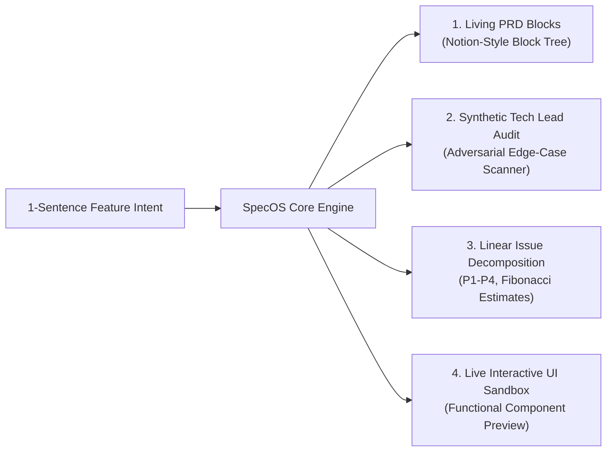

# SpecOS & CommandCenter — Master A-to-Z Project Handoff

> **Instructions for the New LLM:**  
> You are acting as an elite **Technical Product Manager & AI Systems Architect** pair-programming with **Arun Mitra Kommireddy**. Read this entire document carefully before taking any action. It contains all context, technical architecture, design decisions, code status, and strategic goals from Day 0 to the present.

---

## 1. Executive Summary & Core Objective

* **User:** Arun Mitra Kommireddy ([LinkedIn](https://linkedin.com/in/arun7mitra) | arunmitra777@gmail.com | +91 7032279111).
* **Background:** BITS Pilani (M.Sc. Physics + B.E. Mechanical Engineering, 2021–2026).
  * Ex-Edwisely: Business Analyst operating as Product Manager (shipped 0-to-1 features for 120k students, daily puzzle game, parent app).
  * Ex-Swiggy: Analytics Intern (automated daily GMV/AOV reporting, SQL on 3M+ rows).
  * University of Bologna: Computational Astrophysics Research (designed cosmological data pipelines; secured via direct cold outreach).
  * BITS SARC: Editor-in-Chief, Founder of *Alumni Unplugged* podcast.
* **Current Urgency:** Arun is targeting **APM / Technical PM / Founder's Associate** roles within a **30-day window** (due to potential layoff/termination at current company).
* **The Strategy:** Avoid the resume black hole. Instead of sending generic resumes, build and ship a high-agency, jaw-dropping proof-of-work project (**SpecOS / CommandCenter**), record a 90-second video walkthrough, and execute a targeted outbound campaign to BITSian founders, AI startups, and scale-up product leaders.

---

## 2. Product Thesis & Vision: SpecOS $\rightarrow$ CommandCenter

### The Umbrella Concept: CommandCenter
A local-first mission control for technical product leaders and AI engineers that reverse-engineers and fuses:
1. **Linear:** Keyboard-first velocity, optimistic client-side mutations, typed issue state machine.
2. **Notion:** Modular block-based living document tree.
3. **Raycast:** Action palette (`⌘K`), sub-50ms execution, MCP extension runtime.

### Module 1 (Shipped): SpecOS
**SpecOS is an AI-native living PRD & spec engine that turns a 1-sentence feature prompt into an edge-case-hardened specification with auto-decomposed Linear tickets and live interactive UI mockups in 30 seconds.**



---

## 3. Technical Architecture & Design Principles

### Tech Stack
* **Framework:** React 19 + Vite 6 + TypeScript (strict mode).
* **Styling & Aesthetics:** Tailwind CSS + custom Apple Design tokens + Lucide Icons.
* **Motion & Springs:** Matt Perry's `motion` (`motion/react`) implementing **Apple WWDC / Emil Kowalski fluid interface guidelines** (critically damped springs: `damping: 25, stiffness: 350`, `apple-pressable` scale feedback on pointer-down).
* **Storage & Latency:** Local-first (0ms mutation, zero server dependency, works completely offline).
* **Deployment:** Vercel (static edge deployment).

### Repository Structure
```text
radiant-babbage/ (or specos/)
├── docs/
│   ├── PRD.md                         # Formal Product Requirements Document
│   ├── TEARDOWN.md                    # Reverse-engineering teardown of Linear & Notion
│   ├── DEMO_VIDEO_SCRIPT.md           # Second-by-second 90s video recording script
│   ├── OUTREACH_PLAYBOOK.md           # 25-company target roster & cold pitch templates
│   └── adr/
│       ├── ADR-001.md                 # Architecture Decision Record: Local-First vs Cloud
│       └── ADR-001-local-first.md
├── src/
│   ├── components/
│   │   ├── Header.tsx                 # Floating island navigation + segmented view pill
│   │   ├── CommandPalette.tsx         # Native Spotlight ⌘K search & action modal
│   │   ├── PromptBar.tsx              # Input bar + curated preset pills
│   │   ├── PrdViewer.tsx              # Living Notion block tree + interactive Gherkin tests
│   │   ├── TechLeadAudit.tsx          # Adversarial audit (concurrency, idempotency, rate limits)
│   │   ├── LinearDrawer.tsx           # Interactive sprint backlog (status cycle + CSV export)
│   │   ├── MockupContainer.tsx        # Glass bezel preview container
│   │   └── mockups/
│   │       ├── CheckoutMockup.tsx     # Apple Pay sheet with FaceID scan simulation
│   │       ├── SwitcherMockup.tsx     # Keyboard-first workspace switcher with latency clock
│   │       └── CanvasMockup.tsx       # Collaborative checklist with Yjs CRDT sync indicator
│   ├── types/
│   │   ├── spec.ts                    # Core living document contracts
│   │   ├── linear.ts                  # Linear GraphQL issue schema (P1-P4, Fibonacci)
│   │   └── edgecases.ts               # Failure mode contracts
│   ├── data/
│   │   └── presets.ts                 # 3 production-grade preloaded specs
│   ├── App.tsx                        # Master layout with spring view transitions
│   ├── main.tsx
│   └── index.css                      # Apple glass materials, SF Pro font stack
├── tailwind.config.js                 # Apple design system palette
└── package.json
```

---

## 4. Current Work Done & Status

1. **Working Codebase:** 100% written, compiled, tested, and running locally on port 5173.
2. **Apple Design Overhaul Complete:**
   * Replaced generic cards with frosted glass acrylic panels (`backdrop-blur-2xl`, subtle border highlights).
   * Floating segmented island navigation (`Living PRD`, `Tech Lead Audit`, `Linear Sprints`, `Live Sandbox`).
   * Native `⌘K` Spotlight command palette with search, view jumps, and instant actions.
   * Interactive Gherkin acceptance criteria (clickable "Run Test" $\rightarrow$ "Verified" with green pulse).
   * Interactive Linear issue board (clickable status pills: `Backlog` $\rightarrow$ `Todo` $\rightarrow$ `In Progress` $\rightarrow$ `Done`, plus CSV download).
3. **Documentation Suite:** Fully written and committed in `docs/`.
4. **Vercel Deployment:** Preview deployment created (`https://specos-nsk7kl5hh-stardust-e1d2.vercel.app`), pending `--prod` run and disabling Vercel Authentication in dashboard.
5. **Git Status:** 5 commits on local `master` branch. Needs remote push to `https://github.com/stardust2443/specos`.

---

## 5. Master Roadmap & Next Immediate Steps

### Immediate Next Steps (Day 2-3)
1. **Push to GitHub:** Push local commits to `stardust2443/specos` so the repo is public.
2. **Promote Vercel to Production:** Run `vercel --prod` and toggle off Deployment Protection so visitors don't hit a login screen.
3. **Record 90-Second Demo:** Follow docs/DEMO_VIDEO_SCRIPT.md on Loom/Screen Studio.
4. **Launch Outbound Wave 1:** Send 15 messages/day using docs/OUTREACH_PLAYBOOK.md.

### Mid-Term Steps (CommandCenter Module 2 & 3)
* **Module 2: Agent Dispatch Layer:** Take the auto-decomposed Linear tickets and dispatch autonomous coding agents (Claude Code / MCP / REA) to scaffold initial Git branches.
* **Module 3: Full Desktop Mission Control:** Merge the living spec editor, Linear Kanban, and Raycast launcher into a single desktop application window.

---

## 6. How the New LLM Should Interact with Arun

* **Role:** Act as a senior Technical Product Lead and engineering partner.
* **Tone:** Pragmatic, high-conviction, structured, and velocity-obsessed.
* **Do NOT:** Ask him to do LeetCode, write low-level DSA, or get bogged down in non-essential refactoring. Keep him focused on shipping, demoing, and converting recruiter conversations.
