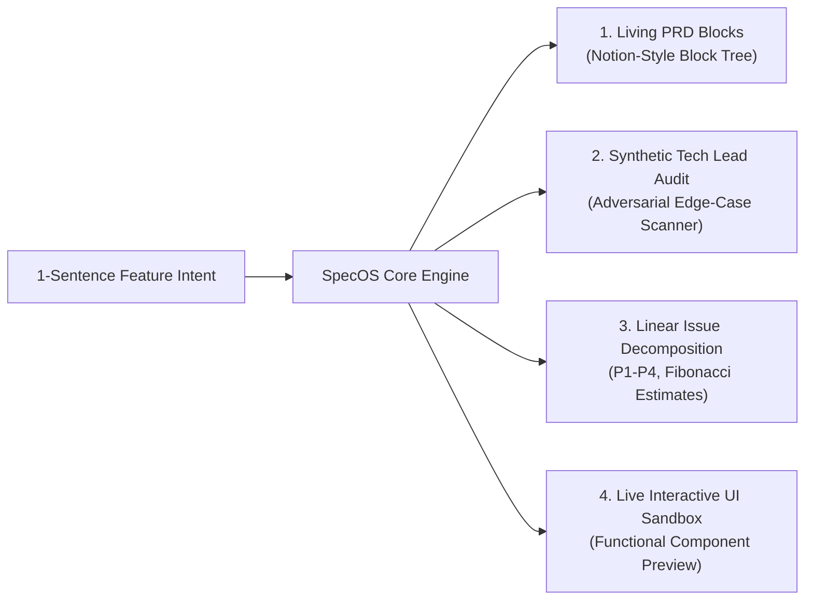

# SpecOS ⚡
> **The Local-First AI PRD & Spec Engine for High-Velocity Product Teams**

[](https://opensource.org/licenses/MIT)
[](docs/TEARDOWN.md)
[-emerald)](docs/adr/ADR-001-local-first-architecture.md)

SpecOS turns a **1-sentence feature prompt** into an executable, edge-case-hardened specification with **auto-generated, typed Linear tickets** and **live interactive UI mockups** in under 30 seconds.

Built by reverse-engineering the ergonomic speed of **Linear** and the modular block hierarchy of **Notion** into a unified, zero-latency desktop client.

---

## 🎯 The Problem

1. **Dead PRDs:** Traditional specs in Notion or Google Docs rot within two weeks because they are disconnected from sprint backlogs.
2. **The "Edge-Case Blindspot":** Junior/Mid PMs default to specifying the happy path. Critical edge cases (concurrency, race conditions, idempotency, rate limits) are only discovered mid-sprint, triggering 25–40% schedule blowups.
3. **Task Decomposition Friction:** Manually translating a prose PRD into 10+ typed Linear tickets with estimates, Gherkin criteria, and priority tags takes 2–4 hours per feature.

---

## ✨ Core Pillars



### 1. Living PRD Blocks (Notion-Inspired)
Structured block tree comprising:
* **North Star KPI Banner:** Quantifiable metric target.
* **Problem Statement & Strategic Context:** Clear business grounding.
* **User Journey & Persona Matrix:** Persona, entry point, target outcome.
* **Gherkin Acceptance Criteria:** Structured `GIVEN... WHEN... THEN...` scenarios.
* **Data Schema & API Contract Diff:** Exact SQL/NoSQL schema migrations and table additions.

### 2. Synthetic Tech Lead Audit (The Secret Weapon)
Before engineers see the spec, an adversarial AI agent stress-tests the feature across 4 failure vectors:
* ⚡ **Concurrency & Race Conditions** (e.g., rapid double-taps, simultaneous mutations)
* 🔁 **Idempotency & Retries** (e.g., webhook vs. client redirect race conditions)
* 🚫 **Rate Limits & Abuse Prevention** (e.g., card testing bots, token exhaustion)
* 🔄 **UX Recovery & Degradation** (e.g., network drops mid-transaction, offline fallback)

### 3. Linear Issue Decomposition
Auto-decomposes user stories into atomic engineering issues:
* Typed priority (`P1 Urgent`, `P2 High`, `P3 Medium`, `P4 Low`)
* Fibonacci complexity points (`1`, `2`, `3`, `5`, `8`)
* Functional area tags (`Backend`, `Frontend`, `Infra`, `Security`)
* **1-Click Export to Linear JSON / Markdown**.

### 4. Live Interactive Component Mockups
Inline sandbox rendering a functional, interactive UI prototype (e.g., simulating mobile Apple Pay authorization sheets, multi-workspace switches, or collaborative thread canvases) directly inside the living PRD.

---

## 🛠️ Technical Architecture & Design Decisions

* **UI & Rendering:** React 19, Vite, Tailwind CSS, Lucide Icons.
* **State Machine:** Zustand with local-first persistent storage.
* **Latency Profile:** Sub-50ms local mutations, instant page load.
* **Documentation & Rigor:**
  * 📄 [Product Requirements Document (PRD)](docs/PRD.md)
  * 🏗️ [ADR-001: Local-First Architecture](docs/adr/ADR-001-local-first-architecture.md)
  * 🔬 [Reverse-Engineering Teardown: Linear & Notion](docs/TEARDOWN.md)

---

## 🚀 Quick Start

```bash
# Clone the repository
git clone https://github.com/your-username/specos.git

# Install dependencies
npm install

# Start development server
npm run dev

# Production build
npm run build
```

---

## 👤 Author

**Arun Mitra Kommireddy**  
*Solo AI Product Manager & Technical Builder*  
* BITS Pilani (M.Sc. Physics + B.E. Mechanical Engineering)  
* Product Manager at Edwisely (discovery, design & delivery for 120k students)  
* Analytics at Swiggy (automated high-volume operations pipelines)  
* Direct Outreach & Astrophysics Research at University of Bologna, Italy  

📫 **Contact:** [LinkedIn](https://linkedin.com/in/arun7mitra) | arunmitra777@gmail.com | +91 7032279111
